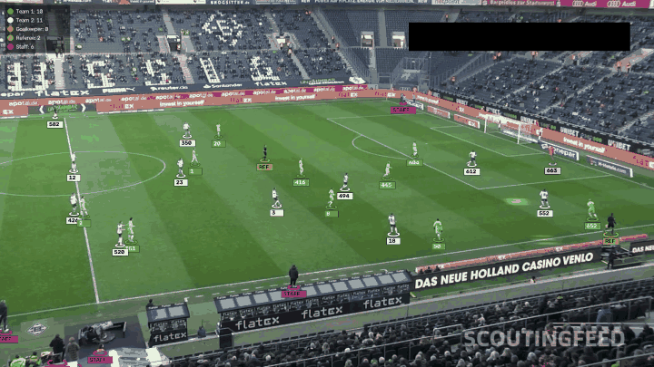
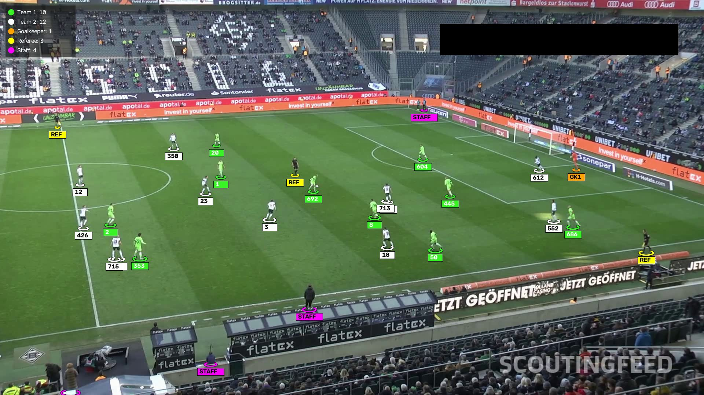
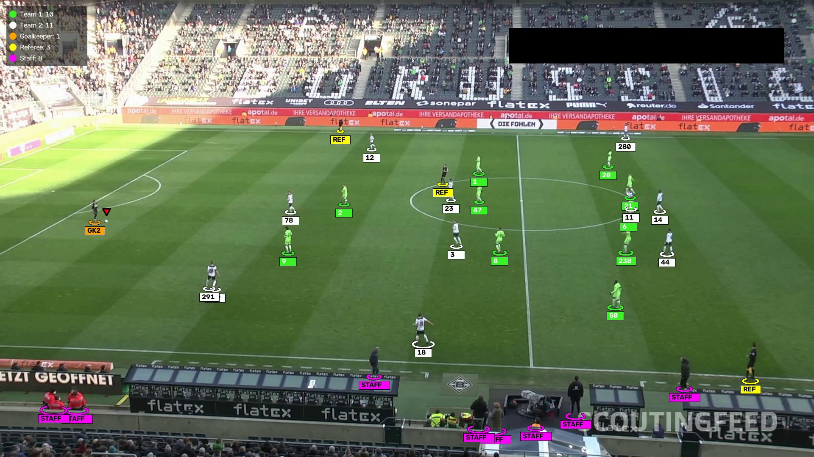

# Football Player & Team Tracking

Computer vision system that analyzes football match footage to detect, track and identify **everyone on the pitch**: players of each team, goalkeepers, referees, coaches/bench staff, and the ball.



## Results

| Teams, goalkeeper, referees and staff | Goalkeeper in a dark kit + coaches on the touchline |
|---|---|
|  |  |

What the output video shows:

- **Team-colored ellipse + ID** under every player (team colors are learned automatically)
- **GK1 / GK2** in orange: goalkeeper and the team they belong to
- **REF** in yellow: referee and assistant referees
- **STAFF** in magenta: coaches, substitutes and staff near the pitch
- **Red triangle** above the ball
- **Live counter panel** (players per team, goalkeepers, referees, staff)

## How it works

1. **Detection with a custom YOLOv8 model** (`best.pt`) fine-tuned on the [Roboflow football-players-detection](https://universe.roboflow.com/roboflow-jvuqo/football-players-detection-3zvbc) dataset (4 classes: ball, goalkeeper, player, referee).

   | Class | mAP50 |
   |---|---|
   | player | 0.983 |
   | goalkeeper | 0.944 |
   | referee | 0.933 |
   | ball | 0.352 |

2. **Staff detection with a second model.** The custom model was never trained on coaches or staff, so a standard COCO `yolov8s.pt` person detector finds everyone else. People it finds that the custom model does not, standing near the pitch and not wearing a team kit, are labelled **STAFF**. The crowd is ignored using the green pitch area.

3. **Tracking with ByteTrack.** Each person keeps the same ID across frames.

4. **Unsupervised team assignment.** For each player, the jersey area is cropped, the background is removed with K-Means (k=2), and the jersey color is converted to the **Lab** color space. A second K-Means on the first frames learns the two team kits automatically. No colors are hard-coded.

5. **Combining model + kit color + position** to fix the model's mistakes:

   | Model says | Kit color | Final label |
   |---|---|---|
   | referee | not a team kit | **Referee** |
   | referee | a team kit | **Player** (referees must wear colors different from both teams) |
   | player / goalkeeper | not a team kit, on the pitch | **Goalkeeper** |
   | player / goalkeeper | a team kit | **Player** of that team |
   | player / goalkeeper | outside the pitch | **Staff** (substitutes) |

6. **Temporal voting.** Roles, kits and the goalkeeper's team are decided over many frames instead of a single one, so labels do not flicker. A goalkeeper belongs to the team whose players are, on average, closest to them.

## Project structure

```
├── main.py                        # first version: COCO person detector + team colors
├── try/
│   ├── Track_person_stadium.ipynb # training the custom YOLOv8 model (Google Colab)
│   ├── best.pt                    # trained model weights
│   ├── test.py                    # version 2: custom model (player / goalkeeper / referee)
│   ├── test_v2.py                 # final version: + staff, goalkeeper by kit, referee fix, ball, legend
│   └── video.mp4                  # sample match video
├── yolov8s.pt                     # COCO model used for staff detection
└── assets/                        # README images
```

## Run it

```bash
pip install ultralytics opencv-python scikit-learn numpy
cd try
python test_v2.py
```

The result is saved as `try/output_v2.mp4`. All settings (input video, models, confidence, voting frames, etc.) are in the `Config` class at the top of `test_v2.py`.

Tips:
- Set `max_frames = 200` for a quick test.
- On CPU the staff detector is the slow part. Lower `person_imgsz` or set `person_model = None` to make it faster.

## Tech stack

Python · YOLOv8 (Ultralytics) · OpenCV · ByteTrack · Scikit-learn (K-Means) · NumPy · Roboflow · Google Colab
